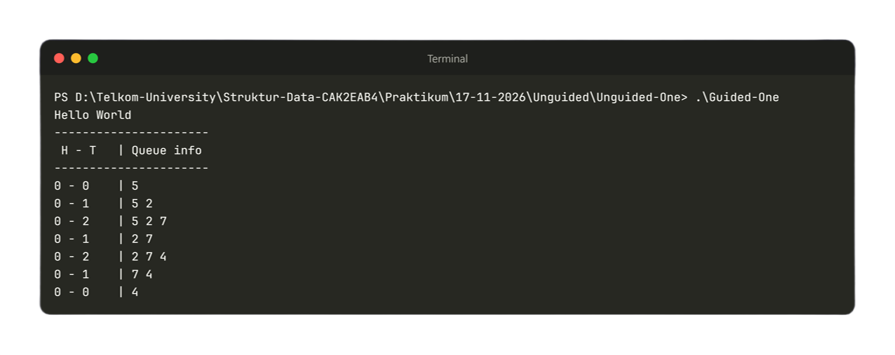
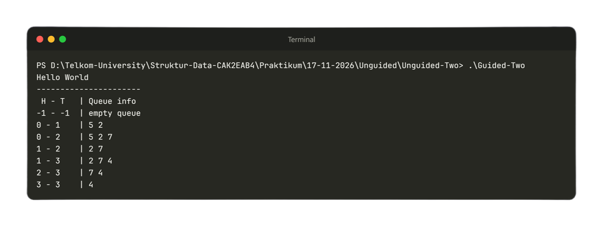
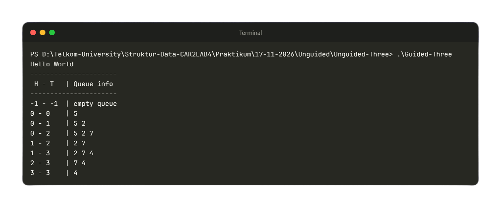

<h1 align="center">Laporan Praktikum Modul 8 - Queue</h1>
<p align="center">Yudwitama Ahlan Putra Hayuning Bawana - 109082530016</p>

## Dasar Teori

Queue atau antrean merupakan salah satu struktur data linier yang bekerja dengan meniru cara kerja antrean di kehidupan sehari-hari, seperti antrean pada loket tiket atau pelayanan kasir [[1]](http://repository.uinsu.ac.id/9717/2/Diktat%20Struktur%20Data.pdf). Prinsip utama yang digunakan pada struktur data Queue adalah FIFO (_First In First Out_), artinya elemen data yang pertama kali masuk ke dalam antrean akan menjadi elemen pertama juga yang dikeluarkan atau dilayani [[3]](https://journalcenter.org/index.php/jupti/article/view/4170). Berbeda dengan Stack yang hanya menggunakan satu ujung akses (_Top_), Queue memiliki dua penanda posisi utama yaitu _Head_ (_Front_) sebagai ujung depan tempat data keluar dan _Tail_ (_Rear_) sebagai ujung belakang tempat data baru masuk [[5]](https://www.dicoding.com/blog/struktur-data-queue-pengertian-fungsi-dan-jenisnya/). Dalam pemrograman C++, pembuatan _Abstract Data Type_ (ADT) Queue biasanya dipisahkan ke dalam file header (`.h`) untuk deklarasi tipe data beserta prototipe fungsinya, dan file implementasi (`.cpp`) untuk logika programnya [[2]](https://press.umsida.ac.id/index.php/umsidapress/article/view/978-623-6833-67-4).

### A. Konsep Dasar dan Operasi Utama Queue<br/>

Agar sebuah antrean dapat berjalan sesuai aturan FIFO, terdapat beberapa operasi dasar (primitif) yang digunakan untuk mengelola alur keluar-masuknya elemen [[4]](https://journal.stiestekom.ac.id/index.php/TEKNIK/article/view/976):

#### 1. CreateQueue dan Pengecekan Kondisi (isEmpty & isFull)

Operasi `CreateQueue` berfungsi untuk menyiapkan wadah antrean baru yang masih kosong di awal program. Pada representasi pointer, kondisi kosong ditandai dengan mengatur `head` dan `tail` ke `Nil` (`NULL`), sedangkan pada representasi array biasanya diberi nilai awal `-1`. Fungsi `isEmpty` dipakai untuk mengecek apakah antrean sedang kosong sebelum mengambil data, sementara `isFull` digunakan khusus pada Queue berbasis array untuk mengecek apakah kapasitas penyimpanan sudah penuh [[1]](http://repository.uinsu.ac.id/9717/2/Diktat%20Struktur%20Data.pdf).

#### 2. Insert / Enqueue (Penyisipan Elemen)

Operasi `enqueue` atau `insert` adalah proses menambahkan data baru ke bagian paling belakang antrean (_tail_) [[5]](https://www.dicoding.com/blog/struktur-data-queue-pengertian-fungsi-dan-jenisnya/). Jika antrean awalnya masih kosong, maka elemen pertama yang masuk akan langsung ditunjuk oleh `head` sekaligus `tail`. Namun jika sudah ada elemen di dalamnya, penanda `tail` akan dimajukan ke posisi berikutnya untuk menyimpan elemen baru tersebut [[3]](https://journalcenter.org/index.php/jupti/article/view/4170).

#### 3. Delete / Dequeue (Pengambilan Elemen)

Operasi `dequeue` atau `delete` adalah proses mengeluarkan elemen yang berada di posisi paling depan antrean (_head_) [[4]](https://journal.stiestekom.ac.id/index.php/TEKNIK/article/view/976). Setelah elemen di posisi `head` diambil, posisi `head` akan disesuaikan ke elemen di belakangnya, atau seluruh elemen digeser maju tergantung mekanisme yang dipakai. Apabila elemen yang dikeluarkan adalah elemen terakhir di dalam antrean, maka nilai `head` dan `tail` akan dikembalikan ke kondisi kosong.

### B. Representasi Struktur Data Queue<br/>

Secara teknis, Queue pada bahasa C++ dapat dibangun menggunakan dua pendekatan memori yang berbeda, yaitu menggunakan pointer (_Linked List_) dan menggunakan tabel (_Array_) [[1]](http://repository.uinsu.ac.id/9717/2/Diktat%20Struktur%20Data.pdf):

#### 1. Representasi Fisik Pointer (Linked List)

Pada representasi pointer, setiap elemen disimpan di dalam _node_ yang dialokasikan secara dinamis di memori dan saling terhubung lewat pointer `next`. Kelebihan utamanya adalah ukuran antrean bersifat fleksibel mengikuti sisa memori komputer, serta proses `delete` cukup memindahkan pointer `head` ke `head->next` tanpa perlu menggeser data satu per satu.

#### 2. Representasi Tabel Alternatif 1 dan Alternatif 2 (Linear Array)

Pada representasi tabel (array), kapasitas maksimum antrean sudah ditentukan sejak awal [[1]](http://repository.uinsu.ac.id/9717/2/Diktat%20Struktur%20Data.pdf). Terdapat dua pendekatan linear:

- **Alternatif 1 (Head Diam, Tail Bergerak):** Indeks `head` selalu bertahan di indeks `0` selama antrean berisi data. Saat terjadi `dequeue`, seluruh elemen di belakang `head` harus digeser maju satu indeks ke kiri dan `tail` mundur satu langkah. Cara ini mudah dibayangkan seperti antrean orang di dunia nyata, tetapi kurang efisien jika datanya banyak karena harus melakukan perulangan geser data.
- **Alternatif 2 (Head Bergerak, Tail Bergerak):** Saat terjadi `dequeue`, elemen tidak perlu digeser ke kiri, melainkan indeks `head` yang langsung maju (`head++`). Cara ini lebih cepat, tetapi memiliki kelemahan yaitu kondisi penuh semu (_false overflow_) ketika `tail` sudah mentok di indeks terakhir padahal indeks awal di depan `head` sebenarnya sudah kosong.

#### 3. Representasi Tabel Alternatif 3 (Circular Queue)

Alternatif 3 atau _Circular Queue_ mengatasi masalah penuh semu pada Alternatif 2 dengan membuat indeks `head` dan `tail` seolah-olah berputar mengelilingi array [[3]](https://journalcenter.org/index.php/jupti/article/view/4170). Menggunakan operasi modulo (`(index + 1) % MAKSIMAL`), ketika posisi `tail` atau `head` sudah mencapai ujung akhir array dan masih ada ruang kosong di indeks awal (`0`), penanda akan langsung berputar kembali ke indeks `0` tanpa perlu menggeser elemen [[5]](https://www.dicoding.com/blog/struktur-data-queue-pengertian-fungsi-dan-jenisnya/).

## Guided

### 1. Guided 1 - Implementasi Queue Menggunakan Linked List (Pointer)

#### [Header - queue.h]

```C++
#ifndef QUEUE_H_INCLUDE
#define QUEUE_H_INCLUDE

#include <iostream>
using namespace std;

#define Nil NULL

typedef bool boolean;
typedef int infotype;
typedef struct elmQ *address;

struct elmQ {
    infotype info;
    address next;
};

struct queue {
    address head, tail;
};

boolean isEmpty(queue Q);
void CreateQueue(queue &Q);
address alokasi(infotype X);
void dealokasi(address P);
address findElm(queue Q, infotype X);
boolean fFindElm(queue Q, address P);
void insert(queue &Q, address P);
void deleteQueue(queue &Q, address &P);
void printInfo(queue Q);
int nbList(queue Q);
void delAll(queue &Q);

#endif
```

Pada file header `queue.h` bagian Guided 1 ini, kita menyiapkan kerangka ADT Queue yang berbasis pointer (_linked list_). Di bagian atas ada `#define Nil NULL` serta pembuatan alias tipe data menggunakan `typedef`, yaitu `boolean` untuk `bool`, `infotype` berupa `int` sebagai nilai datanya, dan `address` sebagai pointer yang menunjuk ke struct `elmQ`. Struct `elmQ` sendiri berperan sebagai _node_ yang menyimpan nilai `info` dan pointer `next`, sedangkan struct `queue` menyimpan dua pointer utama yaitu `head` (depan) dan `tail` (belakang). Di bagian bawahnya, dideklarasikan seluruh prototipe fungsi mulai dari manajemen memori (`alokasi`, `dealokasi`), pencarian (`findElm`, `fFindElm`), hingga operasi antrean (`insert`, `deleteQueue`, `printInfo`, `nbList`, dan `delAll`).

#### [Implementasi - queue.cpp]

```C++
#include "queue.h"

boolean isEmpty(queue Q) {
    return (Q.head == Nil);
}

void CreateQueue(queue &Q) {
    Q.head = Nil;
    Q.tail = Nil;
}

address alokasi(infotype X) {
    address P = new (nothrow) elmQ;
    if (P != Nil) {
        P->info = X;
        P->next = Nil;
    }
    return P;
}

void dealokasi(address P) {
    delete P;
}

address findElm(queue Q, infotype X) {
    address P = Q.head;
    while (P != Nil) {
        if (P->info == X) {
            return P;
        }
        P = P->next;
    }
    return Nil;
}

boolean fFindElm(queue Q, address P) {
    address R = Q.head;
    while (R != Nil) {
        if (R == P) {
            return true;
        }
        R = R->next;
    }
    return false;
}

void insert(queue &Q, address P) {
    if (isEmpty(Q)) {
        Q.head = P;
        Q.tail = P;
    } else {
        (Q.tail)->next = P;
        Q.tail = P;
    }
}

void deleteQueue(queue &Q, address &P) {
    P = Q.head;
    if (Q.head == Q.tail) {
        Q.head = Nil;
        Q.tail = Nil;
    } else {
        Q.head = P->next;
    }
    P->next = Nil;
}

void printInfo(queue Q) {
    if (isEmpty(Q)) {
        cout << "Queue kosong" << endl;
    } else {
        address P = Q.head;
        while (P != Nil) {
            cout << P->info << " ";
            P = P->next;
        }
        cout << endl;
    }
}

int nbList(queue Q) {
    int jumlah = 0;
    address P = Q.head;
    while (P != Nil) {
        jumlah++;
        P = P->next;
    }
    return jumlah;
}

void delAll(queue &Q) {
    address P;
    while (!isEmpty(Q)) {
        deleteQueue(Q, P);
        dealokasi(P);
    }
}
```

File `queue.cpp` ini berisi logika dari semua fungsi yang sudah dideklarasikan di header tadi. Fungsi `CreateQueue` mengatur `head` dan `tail` menjadi `Nil`, dan `isEmpty` cukup mengecek apakah `Q.head == Nil`. Saat ingin menambah data, fungsi `alokasi` membuat _node_ baru di memori menggunakan `new (nothrow) elmQ`, lalu prosedur `insert` memasukkan _node_ tersebut ke bagian `tail` (jika antrean masih kosong, `head` dan `tail` sama-sama menunjuk ke _node_ baru itu). Sebaliknya, pada `deleteQueue`, elemen paling depan (`Q.head`) ditampung ke pointer `P`, lalu `Q.head` digeser ke `P->next`, atau di-set `Nil` keduanya jika elemen di dalam antrean tinggal satu. Selain itu, ada fungsi `findElm` dan `fFindElm` untuk menelusuri elemen dari `head` sampai `Nil`, `nbList` untuk menghitung banyaknya elemen yang sedang mengantre, serta `delAll` untuk mengosongkan seluruh isi antrean sekaligus menghapusnya dari memori lewat `dealokasi`.

#### [Program Utama - main.cpp]

```C++
#include <iostream>
#include "queue.h"
using namespace std;

int main() {
    queue Q;
    address P;

    CreateQueue(Q);
    cout << "isEmpty : " << isEmpty(Q) << endl;
    printInfo(Q);

    insert(Q, alokasi(5));
    insert(Q, alokasi(2));
    insert(Q, alokasi(7));
    cout << "Setelah insert 5, 2, 7" << endl;
    printInfo(Q);
    cout << "nbList : " << nbList(Q) << endl;

    P = findElm(Q, 2);
    if (P != Nil) {
        cout << "findElm(2) ketemu, info = " << P->info << endl;
        cout << "findElm : " << fFindElm(Q, P) << endl;
    }
    if (findElm(Q, 9) == Nil) {
        cout << "findElm(9) tidak ketemu" << endl;
    }

    deleteQueue(Q, P);
    cout << "Setelah delete, elemen yang keluar = " << P->info << endl;
    dealokasi(P);
    printInfo(Q);

    delAll(Q);
    cout << "Setelah delAll" << endl;
    printInfo(Q);
    cout << "isEmpty : " << isEmpty(Q) << endl;

    return 0;
}
```

Di file `main.cpp` pada Guided 1, kita menguji seluruh fungsi Queue berbasis linked list secara berurutan. Pertama, antrean `Q` dibuat kosong lalu dicek status `isEmpty`-nya (menghasilkan `1` atau _true_). Setelah itu, kita memasukkan tiga angka berturut-turut yaitu `5`, `2`, dan `7` memakai kombinasi `insert` dan `alokasi`, lalu mencetak isinya dan menghitung jumlah datanya lewat `nbList`. Berikutnya dilakukan uji pencarian angka `2` (ditemukan) dan angka `9` (tidak ditemukan). Saat `deleteQueue(Q, P)` dipanggil, angka `5` yang pertama kali masuk akan keluar lebih dulu sesuai prinsip FIFO, menyisakan `2` dan `7`. Terakhir, `delAll(Q)` dipanggil untuk membersihkan semua sisa antrean hingga kembali kosong.

### 2. Guided 2 - Implementasi Queue Menggunakan Array (Tabel)

#### [Header - queue.h]

```C++
#ifndef QUEUE_H
#define QUEUE_H

#include <iostream>
using namespace std;

const int MAKSIMAL = 5;

struct queue {
    string nama[MAKSIMAL];
    int head;
    int tail;
};

bool isFull(queue Q);
bool isEmpty(queue Q);
void CreateQueue(queue &Q);
void enQueue(queue &Q, string nama);
void deQueue(queue &Q);
void viewQueue(queue Q);

#endif
```

Pada file `queue.h` untuk Guided 2, implementasi Queue beralih menggunakan media penyimpanan array statis. Kapasitas maksimal antrean dibatasi sebanyak 5 elemen lewat konstanta `MAKSIMAL = 5`. Di dalam struct `queue`, terdapat array `nama[MAKSIMAL]` bertipe `string` untuk menampung daftar nama pengantre, serta variabel `head` dan `tail` bertipe `int` untuk mencatat indeks posisi depan dan belakang array. Prototipe fungsi yang disiapkan meliputi pengecekan `isFull` dan `isEmpty`, inisialisasi `CreateQueue`, penambahan data `enQueue`, penghapusan data `deQueue`, dan penampilan isi antrean `viewQueue`.

#### [Implementasi - queue.cpp]

```C++
#include "queue.h"
#include <iostream>

using namespace std;

// NOTE :
// Implementasi 1 = head diam, tail bergerak (Queue Linear Statis, kerana head nya tetap diam)
// Implementasi 2 = head bergerak, tail bergerak (Queue Linear Dinamis, karena head & tail nya sama-sama bergerak)
// Implementasi 3 = head dan tail berputar (Queue Circular, karena jika udh mentok tapi masih ada space, diputar sehingga tail bisa ada didepan head)

bool isEmpty(queue Q){
    if(Q.head == -1 && Q.tail == -1){
        return true;
    } else {
        return false;
    }
}

//isFull implmenetasi 1 & 2
bool isFull(queue Q){
    if(Q.tail == MAKSIMAL - 1){
        return true;
    } else {
        return false;
    }
}

// //isFull implementasi 3
// bool isFull(queue Q){
//     if((Q.tail + 1) % MAKSIMAL == Q.head){
//         return true;
//     } else {
//         return false;
//     }
// }

void CreateQueue(queue &Q){ //terbentuk queue dengan head = -1 dan tail = -1
    Q.head = -1;
    Q.tail = -1;
}


//enqueue implementasi 1 & 2
void enQueue(queue &Q, string nama){
    if(isFull(Q) == true){
        cout << "Queue sudah penuh!" << endl;
    } else {
        if(isEmpty(Q) == true){
            Q.head = Q.tail = 0;
        } else {
            Q.tail++;
        }
        Q.nama[Q.tail] = nama;
        cout << "nama " << nama << " berhasil ditambahkan kedalam queue!" << endl;
    }
}

// //enQueue implementasi 3
// void enQueue(queue &Q, string nama){
//     if(isFull(Q) == true){
//         cout << "Queue sudah penuh!" << endl;
//     } else {
//         if(isEmpty(Q) == true){
//             Q.head = Q.tail = 0;
//         } else {
//             Q.tail = (Q.tail + 1) % MAKSIMAL; // bergerak melingkar
//         }
//         Q.nama[Q.tail] = nama;
//         cout << "nama " << nama << " berhasil ditambahkan kedalam queue!" << endl;
//     }
// }

//dequeue implementasi 1
void deQueue(queue &Q){
    if(isEmpty(Q) == true){
        cout << "Queue kosong!" << endl;
    } else {
        cout << "Mengahapus data " << Q.nama[Q.head] << "..." << endl;
        for(int i = 0; i < Q.tail; i++){
            Q.nama[i] =  Q.nama[i+1];
        }
        Q.tail--;
        if(Q.tail < 0){ //kalo semua isi queue nya udh dikelaurin, set head & tail ke -1
            Q.head = -1;
            Q.tail = -1;
        }
    }
}

// //dequeue implementasi 2
// void deQueue(queue &Q){
//     if(isEmpty(Q) == true){
//         cout << "Queue kosong!" << endl;
//     } else {
//         cout << "Mengahapus data " << Q.nama[Q.head] << "..." << endl;
//         Q.head++;
//         if(Q.head > Q.tail){ //kalo elemennya udh abis (head akan lebih 1 dari tail), maka reset ulang head & tail ke -1
//             Q.head = -1;
//             Q.tail = -1;
//         }
//     }
// }

// //deQueue implementasi 3
// void deQueue(queue &Q){
//     if(isEmpty(Q) == true){
//         cout << "Queue kosong!" << endl;
//     } else {
//         cout << "Mengahapus data " << Q.nama[Q.head] << "..." << endl;
//         if(Q.head == Q.tail){ //kalo elemennya tinggal 1, langsungkan saja head & tail nya reset ke -1
//             Q.head = -1;
//             Q.tail = -1;
//         } else {
//             Q.head = (Q.head + 1) % MAKSIMAL; // bergerak melingkar
//         }
//     }
// }

//viewQueue implementasi 1 & 2
void viewQueue(queue Q){
    if(isEmpty(Q) == true){
        cout << "Queue kosong!" << endl;
    } else {
        for(int i = Q.head; i <= Q.tail; i++){
            cout << i -  Q.head + 1 << ". " << Q.nama[i] << endl;
        }
    }
    cout << endl;
}

// //viewQueue implementasi 3
// void viewQueue(queue Q){
//     if(isEmpty(Q) == true){
//         cout << "Queue kosong!" << endl;
//     } else {
//         int i = Q.head;
//         int count = 1;
//         while(true){
//             cout << count << ". " << Q.nama[i] << endl;
//             if(i == Q.tail){
//                 break;
//             }
//             i = (i + 1) % MAKSIMAL;
//             count++;
//         }
//     }
// }
```

File `queue.cpp` pada Guided 2 memperlihatkan perbandingan langsung antara ketiga alternatif mekanisme Queue menggunakan array. Kode yang aktif dijalankan menggunakan **Implementasi 1 (head diam, tail bergerak)**, sedangkan kode untuk Implementasi 2 dan 3 disertakan dalam bentuk komentar sebagai bahan pembelajaran. Saat antrean dibuat lewat `CreateQueue`, `head` dan `tail` diberi nilai `-1`. Pada `enQueue`, jika antrean belum penuh (`Q.tail < MAKSIMAL - 1`), elemen pertama akan mengubah `head` dan `tail` ke indeks `0`, dan elemen selanjutnya cukup menaikkan `tail++`. Pada `deQueue` Implementasi 1, data di indeks `head` (`0`) dihapus dengan cara menggeser seluruh elemen di belakangnya maju satu indeks ke kiri (`Q.nama[i] = Q.nama[i+1]`), lalu `tail` dikurangi satu. Jika setelah dikurangi nilai `tail` menjadi kurang dari `0`, artinya antrean sudah habis sehingga `head` dan `tail` dikembalikan ke `-1`.

#### [Program Utama - main.cpp]

```C++
#include "queue.h"
#include <iostream>

using namespace std;

int main(){
    queue Q;

    CreateQueue(Q);
    enQueue(Q, "Dimas");
    enQueue(Q, "Arvin");
    enQueue(Q, "Rizal");
    enQueue(Q, "Hafizh");
    enQueue(Q, "Fathur");
    enQueue(Q, "Daffa");
    cout << endl;

    cout << "--- Isi Queue Setelah enQueue ---" << endl;
    viewQueue(Q);
    cout << endl;

    deQueue(Q);
    deQueue(Q);
    deQueue(Q);
    deQueue(Q);
    // deQueue(Q);
    // deQueue(Q);
    cout << endl;

    cout << "--- Isi Queue Setelah deQueue ---" << endl;
    viewQueue(Q);

    return 0;
}
```

Pada `main.cpp` bagian Guided 2, program menguji kapasitas maksimal dan proses pergeseran antrean. Setelah `CreateQueue(Q)` dijalankan, kita mencoba melakukan `enQueue` sebanyak 6 nama (`Dimas`, `Arvin`, `Rizal`, `Hafizh`, `Fathur`, dan `Daffa`). Karena ukuran array `MAKSIMAL` hanya 5, lima nama pertama berhasil masuk ke antrean, sedangkan nama keenam (`Daffa`) otomatis ditolak dengan pesan `"Queue sudah penuh!"`. Selanjutnya `viewQueue(Q)` menampilkan kelima nama tersebut secara berurutan. Setelah itu fungsi `deQueue(Q)` dipanggil sebanyak 4 kali sehingga 4 pengantre terdepan (`Dimas`, `Arvin`, `Rizal`, dan `Hafizh`) keluar dari antrean, dan ketika `viewQueue(Q)` dipanggil kembali, hanya tersisa `Fathur` yang kini bergeser menempati urutan pertama.

## Unguided

### 1. Buatlah ADT Queue menggunakan ARRAY sebagai berikut di dalam file "queue.h":

```
Type infotype: integer
Type Queue: <
    info : array [5] of infotype {index array dalam C++ dimulai dari 0}
    head, tail : integer
>
procedure CreateQueue (input/output Q: Queue)
function isEmptyQueue (Q: Queue) -> boolean
function isFullQueue (Q: Queue) -> boolean
procedure enqueue (input/output Q: Queue, input x: infotype)
function dequeue (input/output Q: Queue) -> infotype
procedure printInfo (input Q: Queue)
```

Buatlah implementasi ADT Queue pada file "queue.cpp" dengan menerapkan mekanisme queue Alternatif 1 (head diam, tail bergerak).

#### [Header - queue.h]

```C++
#ifndef QUEUE_H
#define QUEUE_H

#include <iostream>
using namespace std;

const int MAKSIMAL = 5;
typedef int infotype;

struct Queue {
    infotype info[MAKSIMAL];
    int head;
    int tail;
};

void createQueue(Queue &Q);
bool isEmptyQueue(Queue Q);
bool isFullQueue(Queue Q);
void enqueue(Queue &Q, infotype x);
infotype dequeue(Queue &Q);
void printInfo(Queue Q);

#endif
```

Pada file `queue.h` ini, kita mendefinisikan struktur ADT `Queue` sesuai ketentuan soal pada modul. Kita menetapkan konstanta `MAKSIMAL = 5` dan `typedef int infotype` agar tipe data elemennya berupa bilangan bulat (`integer`). Di dalam struct `Queue`, terdapat array `info` berukuran 5 elemen beserta variabel integer `head` dan `tail`. Seluruh prototipe fungsi dan prosedur seperti `createQueue`, `isEmptyQueue`, `isFullQueue`, `enqueue`, `dequeue`, dan `printInfo` dideklarasikan di sini agar dapat dipanggil dari `main.cpp`.

#### [Implementasi - queue.cpp]

```C++
#include "queue.h"
#include <iostream>

using namespace std;

void createQueue(Queue &Q) {
    Q.head = -1;
    Q.tail = -1;
}

bool isEmptyQueue(Queue Q) {
    if (Q.head == -1 && Q.tail == -1) {
        return true;
    } else {
        return false;
    }
}

bool isFullQueue(Queue Q) {
    if (Q.tail == MAKSIMAL - 1) {
        return true;
    } else {
        return false;
    }
}

void enqueue(Queue &Q, infotype x) {
    if (isFullQueue(Q) == true) {
        cout << "Queue sudah penuh!" << endl;
    } else {
        if (isEmptyQueue(Q) == true) {
            Q.head = 0;
            Q.tail = 0;
        } else {
            Q.tail++;
        }
        Q.info[Q.tail] = x;
    }
}

infotype dequeue(Queue &Q) {
    if (isEmptyQueue(Q) == true) {
        cout << "Queue kosong!" << endl;
        return -1;
    } else {
        infotype x = Q.info[Q.head];
        for (int i = 0; i < Q.tail; i++) {
            Q.info[i] = Q.info[i + 1];
        }
        Q.tail--;
        if (Q.tail < 0) {
            Q.head = -1;
            Q.tail = -1;
        }
        return x;
    }
}

void printInfo(Queue Q) {
    cout << Q.head << " - " << Q.tail << "\t | ";
    if (isEmptyQueue(Q) == true) {
        cout << "empty queue" << endl;
    } else {
        for (int i = Q.head; i <= Q.tail; i++) {
            cout << Q.info[i] << " ";
        }
        cout << endl;
    }
}
```

Pada file `queue.cpp` untuk Unguided 1, kita menerapkan mekanisme **Alternatif 1 (head diam, tail bergerak)**. Ciri utama mekanisme ini ada pada fungsi `dequeue`: saat elemen terdepan (`Q.info[Q.head]`) diambil dan disimpan ke variabel `x`, seluruh elemen di belakangnya digeser maju satu indeks ke kiri menggunakan perulangan `for (int i = 0; i < Q.tail; i++)`, lalu posisi `Q.tail` dikurangi satu (`Q.tail--`). Dengan cara ini, selama antrean tidak kosong, posisi `head` akan selalu diam di indeks `0`. Jika setelah `tail` dikurangi nilainya menjadi kurang dari `0` (artinya elemen terakhir baru saja dikeluarkan), maka `head` dan `tail` di-reset kembali ke `-1`.

#### [Program Utama - main.cpp]

```C++
#include <iostream>
#include "queue.h"

using namespace std;

int main() {
    cout << "Hello World" << endl;
    Queue Q;
    createQueue(Q);

    cout << "----------------------" << endl;
    cout << " H - T \t | Queue info" << endl;
    cout << "----------------------" << endl;
    printInfo(Q);
    enqueue(Q, 5); printInfo(Q);
    enqueue(Q, 2); printInfo(Q);
    enqueue(Q, 7); printInfo(Q);
    dequeue(Q); printInfo(Q);
    enqueue(Q, 4); printInfo(Q);
    dequeue(Q); printInfo(Q);
    dequeue(Q); printInfo(Q);

    return 0;
}
```

File `main.cpp` ini ditulis mengikuti skenario pengujian pada Gambar 8-18 di modul. Program mencetak header tabel `H - T | Queue info`, lalu menampilkan perubahan nilai indeks `head`, `tail`, dan isi antrean setiap kali operasi `enqueue` (`5`, `2`, `7`, `4`) maupun `dequeue` dijalankan.

### Output Unguided 1 :



Dari hasil output Unguided 1 di atas, terlihat jelas cara kerja Queue Alternatif 1. Saat antrean baru dibuat, `H - T` bernilai `-1 - -1` dengan keterangan `empty queue`. Ketika angka `5`, `2`, dan `7` dimasukkan lewat `enqueue`, indeks `H` (`head`) tetap berada di `0`, sedangkan `T` (`tail`) bergerak naik dari `0`, `1`, hingga `2`. Saat `dequeue` pertama dijalankan, angka `5` keluar dan elemen `2` serta `7` bergeser maju ke indeks `0` dan `1`, sehingga `T` mundur kembali ke `1` sementara `H` tetap diam di `0`. Hal yang sama terjadi saat angka `4` masuk (`T` naik ke `2`) lalu dilakukan `dequeue` dua kali berturut-turut hingga menyisakan angka `4` di indeks `0 - 0`.

### 2. Buatlah implementasi ADT Queue pada file "queue.cpp" dengan menerapkan mekanisme queue Alternatif 2 (head bergerak, tail bergerak).

#### [Header - queue.h]

```C++
#ifndef QUEUE_H
#define QUEUE_H

#include <iostream>
using namespace std;

const int MAKSIMAL = 5;
typedef int infotype;

struct Queue {
    infotype info[MAKSIMAL];
    int head;
    int tail;
};

void createQueue(Queue &Q);
bool isEmptyQueue(Queue Q);
bool isFullQueue(Queue Q);
void enqueue(Queue &Q, infotype x);
infotype dequeue(Queue &Q);
void printInfo(Queue Q);

#endif
```

File `queue.h` pada Unguided 2 tetap menggunakan struktur ADT dan deklarasi fungsi yang sama seperti pada Unguided 1, dengan kapasitas array `MAKSIMAL = 5` serta penanda indeks `head` dan `tail`.

#### [Implementasi - queue.cpp]

```C++
#include "queue.h"
#include <iostream>

using namespace std;

void createQueue(Queue &Q) {
    Q.head = -1;
    Q.tail = -1;
}

bool isEmptyQueue(Queue Q) {
    if (Q.head == -1 && Q.tail == -1) {
        return true;
    } else {
        return false;
    }
}

bool isFullQueue(Queue Q) {
    if (Q.tail == MAKSIMAL - 1) {
        return true;
    } else {
        return false;
    }
}

void enqueue(Queue &Q, infotype x) {
    if (isFullQueue(Q) == true) {
        cout << "Queue sudah penuh!" << endl;
    } else {
        if (isEmptyQueue(Q) == true) {
            Q.head = 0;
            Q.tail = 0;
        } else {
            Q.tail++;
        }
        Q.info[Q.tail] = x;
    }
}

infotype dequeue(Queue &Q) {
    if (isEmptyQueue(Q) == true) {
        cout << "Queue kosong!" << endl;
        return -1;
    } else {
        infotype x = Q.info[Q.head];
        Q.head++;
        if (Q.head > Q.tail) {
            Q.head = -1;
            Q.tail = -1;
        }
        return x;
    }
}

void printInfo(Queue Q) {
    cout << Q.head << " - " << Q.tail << "\t | ";
    if (isEmptyQueue(Q) == true) {
        cout << "empty queue" << endl;
    } else {
        for (int i = Q.head; i <= Q.tail; i++) {
            cout << Q.info[i] << " ";
        }
        cout << endl;
    }
}
```

Pada file `queue.cpp` untuk Unguided 2, kita mengimplementasikan mekanisme **Alternatif 2 (head bergerak, tail bergerak)**. Perbedaan utamanya dibandingkan Unguided 1 terletak pada fungsi `dequeue`: kita tidak lagi menggunakan perulangan `for` untuk menggeser isi array ke kiri, melainkan langsung memajukan posisi indeks `head` satu langkah ke depan (`Q.head++`). Apabila setelah dimajukan nilai `Q.head` melewati `Q.tail` (`Q.head > Q.tail`), itu menandakan seluruh elemen sudah habis dikeluarkan sehingga `head` dan `tail` di-reset kembali ke `-1`. Pada `printInfo`, perulangan dimulai dari `i = Q.head` sampai `Q.tail` agar hanya mencetak elemen yang masih aktif di dalam antrean.

#### [Program Utama - main.cpp]

```C++
#include <iostream>
#include "queue.h"

using namespace std;

int main() {
    cout << "Hello World" << endl;
    Queue Q;
    createQueue(Q);

    cout << "----------------------" << endl;
    cout << " H - T \t | Queue info" << endl;
    cout << "----------------------" << endl;
    printInfo(Q);
    enqueue(Q, 5); printInfo(Q);
    enqueue(Q, 2); printInfo(Q);
    enqueue(Q, 7); printInfo(Q);
    dequeue(Q); printInfo(Q);
    enqueue(Q, 4); printInfo(Q);
    dequeue(Q); printInfo(Q);
    dequeue(Q); printInfo(Q);

    return 0;
}
```

File `main.cpp` menjalankan urutan operasi `enqueue` dan `dequeue` yang sama seperti soal nomor 1 sehingga kita bisa langsung membandingkan pergerakan indeks `H` (`head`) dan `T` (`tail`) antara Alternatif 1 dan Alternatif 2.

### Output Unguided 2 :



Pada output Unguided 2 ini, terlihat bahwa isi antrean yang tampil di kolom `Queue info` sama persis dengan Unguided 1, namun posisi indeks `H - T`-nya berbeda. Saat `dequeue` pertama dipanggil untuk mengeluarkan angka `5`, indeks `H` ikut bergerak maju dari `0` menjadi `1` (`1 - 2 | 2 7`) karena elemen `2` dan `7` tetap berada di indeks `1` dan `2` tanpa digeser. Ketika angka `4` dimasukkan, `T` maju ke indeks `3` (`1 - 3 | 2 7 4`), dan saat `dequeue` dipanggil dua kali lagi, indeks `H` terus maju ke `2` lalu `3` hingga menyisakan angka `4` pada posisi `3 - 3`.

### 3. Buatlah implementasi ADT Queue pada file "queue.cpp" dengan menerapkan mekanisme queue Alternatif 3 (head dan tail berputar).

#### [Header - queue.h]

```C++
#ifndef QUEUE_H
#define QUEUE_H

#include <iostream>
using namespace std;

const int MAKSIMAL = 5;
typedef int infotype;

struct Queue {
    infotype info[MAKSIMAL];
    int head;
    int tail;
};

void createQueue(Queue &Q);
bool isEmptyQueue(Queue Q);
bool isFullQueue(Queue Q);
void enqueue(Queue &Q, infotype x);
infotype dequeue(Queue &Q);
void printInfo(Queue Q);

#endif
```

File `queue.h` untuk Unguided 3 tetap menggunakan struktur data dan prototipe fungsi yang sama sesuai spesifikasi modul.

#### [Implementasi - queue.cpp]

```C++
#include "queue.h"
#include <iostream>

using namespace std;

void createQueue(Queue &Q) {
    Q.head = -1;
    Q.tail = -1;
}

bool isEmptyQueue(Queue Q) {
    if (Q.head == -1 && Q.tail == -1) {
        return true;
    } else {
        return false;
    }
}

bool isFullQueue(Queue Q) {
    if ((Q.tail + 1) % MAKSIMAL == Q.head) {
        return true;
    } else {
        return false;
    }
}

void enqueue(Queue &Q, infotype x) {
    if (isFullQueue(Q) == true) {
        cout << "Queue sudah penuh!" << endl;
    } else {
        if (isEmptyQueue(Q) == true) {
            Q.head = 0;
            Q.tail = 0;
        } else {
            Q.tail = (Q.tail + 1) % MAKSIMAL;
        }
        Q.info[Q.tail] = x;
    }
}

infotype dequeue(Queue &Q) {
    if (isEmptyQueue(Q) == true) {
        cout << "Queue kosong!" << endl;
        return -1;
    } else {
        infotype x = Q.info[Q.head];
        if (Q.head == Q.tail) {
            Q.head = -1;
            Q.tail = -1;
        } else {
            Q.head = (Q.head + 1) % MAKSIMAL;
        }
        return x;
    }
}

void printInfo(Queue Q) {
    cout << Q.head << " - " << Q.tail << "\t | ";
    if (isEmptyQueue(Q) == true) {
        cout << "empty queue" << endl;
    } else {
        int i = Q.head;
        while (true) {
            cout << Q.info[i] << " ";
            if (i == Q.tail) {
                break;
            }
            i = (i + 1) % MAKSIMAL;
        }
        cout << endl;
    }
}
```

Pada file `queue.cpp` untuk Unguided 3, kita menerapkan mekanisme **Alternatif 3 (head dan tail berputar / Circular Queue)**. Di sini kita memanfaatkan operator modulo (`% MAKSIMAL`) supaya pergerakan indeks `head` dan `tail` bisa melingkar kembali ke indeks `0` saat sudah melewati indeks terakhir (`4`). Fungsi `isFullQueue` menyatakan antrean penuh apabila posisi setelah `tail` bertemu langsung dengan `head`, yaitu `(Q.tail + 1) % MAKSIMAL == Q.head`. Pada `enqueue`, penambahan elemen memajukan `tail` dengan rumus `(Q.tail + 1) % MAKSIMAL`. Demikian juga pada `dequeue`, jika elemen tinggal satu (`Q.head == Q.tail`) maka `head` dan `tail` di-reset ke `-1`, tetapi jika masih lebih dari satu maka `head` maju melingkar dengan `Q.head = (Q.head + 1) % MAKSIMAL`. Prosedur `printInfo` juga disesuaikan memakai perulangan `while (true)` yang berjalan melingkar dari `Q.head` dan berhenti ketika indeks `i` sudah mencapai `Q.tail`.

#### [Program Utama - main.cpp]

```C++
#include <iostream>
#include "queue.h"

using namespace std;

int main() {
    cout << "Hello World" << endl;
    Queue Q;
    createQueue(Q);

    cout << "----------------------" << endl;
    cout << " H - T \t | Queue info" << endl;
    cout << "----------------------" << endl;
    printInfo(Q);
    enqueue(Q, 5); printInfo(Q);
    enqueue(Q, 2); printInfo(Q);
    enqueue(Q, 7); printInfo(Q);
    dequeue(Q); printInfo(Q);
    enqueue(Q, 4); printInfo(Q);
    dequeue(Q); printInfo(Q);
    dequeue(Q); printInfo(Q);

    return 0;
}
```

File `main.cpp` menjalankan skenario pengujian sesuai Gambar 8-18 pada modul untuk memverifikasi bahwa operasi `enqueue`, `dequeue`, dan `printInfo` pada _Circular Queue_ berjalan dengan benar.

### Output Unguided 3 :



Dari hasil pengujian Unguided 3 di atas, pergerakan indeks `H` dan `T` berjalan dari `-1 - -1` hingga berakhir di `3 - 3` dengan sisa elemen `4`. Keunggulan utama dari kode Alternatif 3 ini dibandingkan Alternatif 2 adalah ketika nantinya dilakukan penambahan elemen baru lagi setelah `T` mencapai indeks `4` (misalnya ditambah 두 elemen lagi), indeks `T` tidak akan tertahan oleh kondisi penuh semu, melainkan otomatis berputar kembali ke indeks `0` dan `1` selama slot di depan `head` memang sudah kosong.

## Kesimpulan

Berdasarkan praktikum Modul 8 mengenai Queue yang telah dilaksanakan, dapat disimpulkan bahwa Queue merupakan struktur data linier yang bekerja dengan prinsip FIFO (_First In First Out_), di mana penambahan elemen baru selalu dilakukan di ujung belakang (_tail_) melalui operasi `enqueue` dan pengambilan elemen selalu dilakukan dari ujung depan (_head_) melalui operasi `dequeue`. Implementasi Queue menggunakan _Linked List_ (pointer) memberikan fleksibilitas kapasitas memori yang dinamis tanpa batas ukuran tetap, sedangkan implementasi menggunakan _Array_ (tabel) memiliki batas kapasitas maksimum namun dapat dikelola melalui tiga alternatif mekanisme: Alternatif 1 (_head_ diam, _tail_ bergerak) yang selalu menjaga _head_ di indeks awal dengan menggeser elemen saat penghapusan, Alternatif 2 (_head_ dan _tail_ bergerak) yang menghapus elemen secara cepat dengan memajukan _head_ tanpa pergeseran elemen, serta Alternatif 3 (_Circular Queue_) yang paling optimal untuk array karena memanfaatkan operasi modulo agar indeks _head_ dan _tail_ dapat berputar kembali ke indeks awal sehingga menghindari masalah penuh semu (_false overflow_).

## Referensi

[1] Triase. (2020). _Diktat Edisi Revisi : STRUKTUR DATA_. Medan: Universitas Islam Negeri Sumatera Utara Medan. Diakses melalui http://repository.uinsu.ac.id/9717/2/Diktat%20Struktur%20Data.pdf.
<br>[2] Indahyanti, Uce., & Rahmawati, Yunianita. (2020). _"BUKU AJAR ALGORITMA DAN PEMROGRAMAN DALAM BAHASA C++"_. Sidoarjo: Umsida Press. Diakses melalui https://press.umsida.ac.id/index.php/umsidapress/article/view/978-623-6833-67-4.
<br>[3] Trijayanti, Azura., Aulia, Intan., Khairunisa, Nazwa., Purba, Farhan Asyrof Hamadi., & Gunawan, Indra. (2025). _"Implementasi Struktur Data Antrian Queue dalam Sistem Penjadwalan Proses pada Sistem Operasi"_. Jurnal Publikasi Teknik Informatika (JUPTI), 4(2). Diakses melalui https://journalcenter.org/index.php/jupti/article/view/4170.
<br>[4] Dinanti, Augis., Muchtar, Irfan Zaky., Gultom, Jonatan Rio., & Hutabarat, Aldrik Bastio. (2025). _"Perancangan dan Implementasi Website Sistem Antrian Bank Berbasis Queue untuk Efisiensi Pelayanan Nasabah"_. Teknik: Jurnal Ilmu Teknik dan Informatika, 5(2), 93–107. Diakses melalui https://journal.stiestekom.ac.id/index.php/TEKNIK/article/view/976.
<br>[5] Dicoding Intern. (2023). _"Struktur Data Queue: Pengertian, Fungsi, dan Jenisnya"_. Bandung: Dicoding Indonesia. Diakses melalui https://www.dicoding.com/blog/struktur-data-queue-pengertian-fungsi-dan-jenisnya/.
